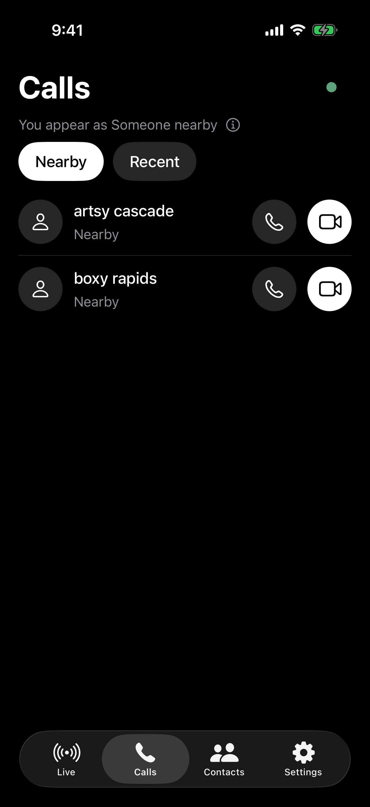
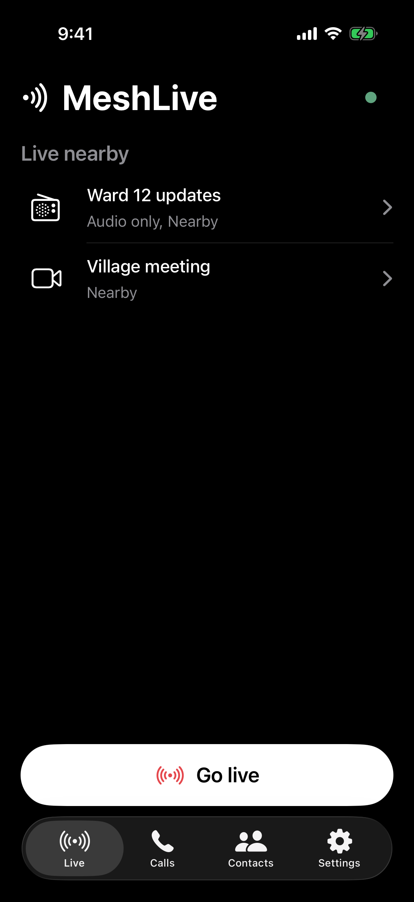
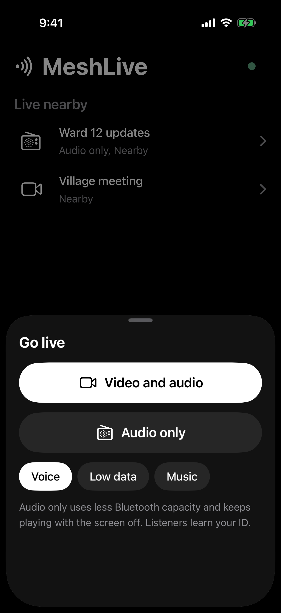
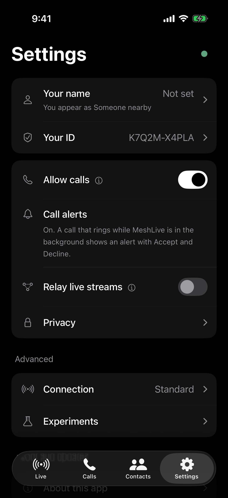
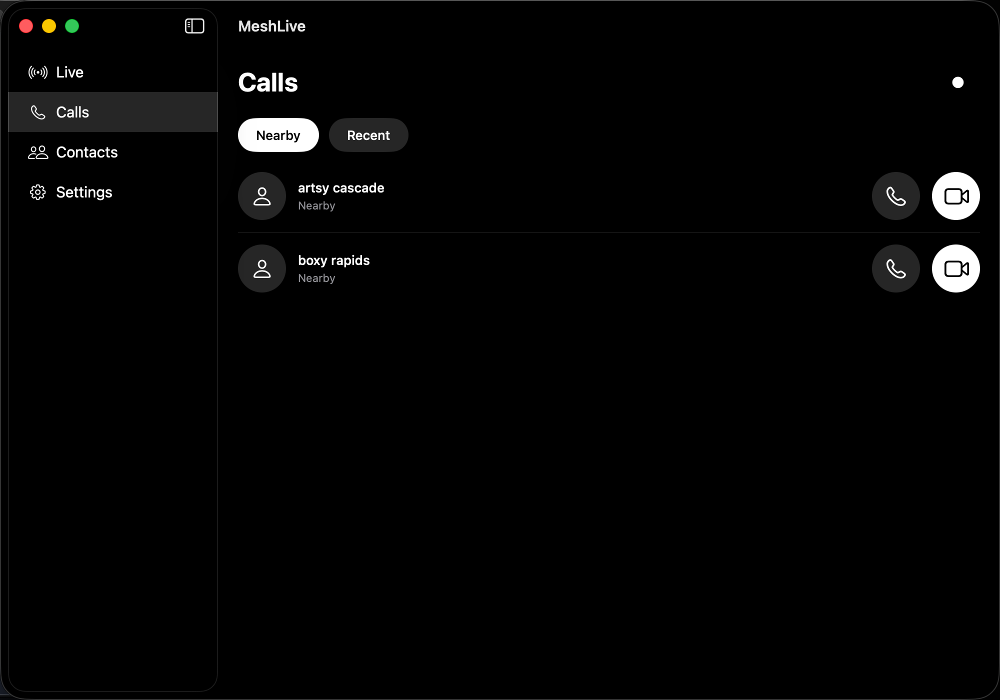
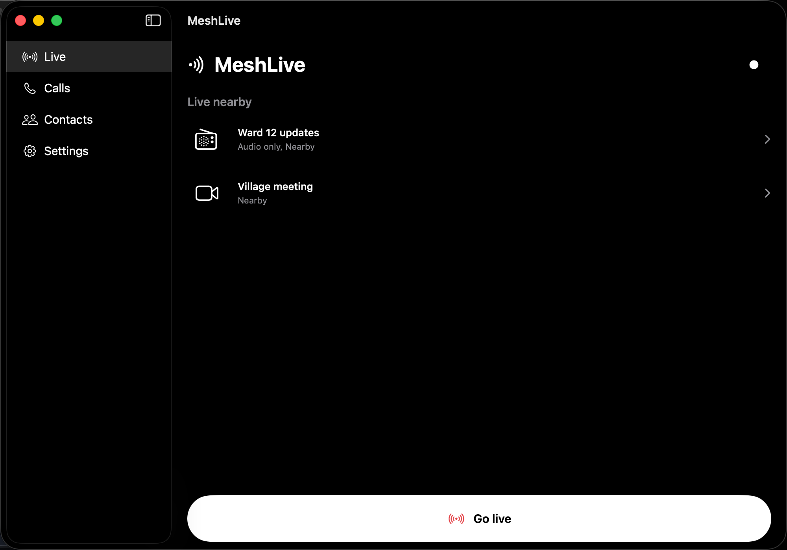

<div align="center">


# MeshLive for iPhone and Mac

Calls and livestreams over a Bluetooth mesh.<br/>
Talk to MeshLive on Android, Windows, iPhone and Mac nearby.<br/>
No internet, no SIM, no account.

<br/>

<p>
  
  
  
  <a href="https://github.com/MeshLive/meshlive-apple/stargazers"></a>
  <a href="https://github.com/MeshLive/meshlive-apple/actions/workflows/ci.yml"></a>
</p>

<a href="docs/dev/building.md#iphone-app-and-package-tests"></a>
&nbsp;
<a href="docs/dev/building.md#native-macos-app-experimental"></a>

<sub>Free · open source · no App Store build yet · <a href="docs/user-guide.md#install">How to install</a></sub>

<br/>
<br/>






<br/>



</div>

## What it does

<table>
<tr>
<td width="50%" valign="top">

**Calls**
- Voice and video calls with people nearby
- End-to-end encrypted, device to device
- Hold Mute to talk, like a walkie-talkie

**Livestream**
- Go live and share your camera with everyone around you
- Audio only, like a local radio that keeps playing with the screen off
- Watch streams from people nearby

</td>
<td width="50%" valign="top">

**Contacts**
- Add people by scanning each other's code
- Call them from Contacts whenever they're nearby
- Strangers see a generated name, not yours

**Your privacy**
- No internet, SIM, account or server
- Your calls never touch the internet
- Erase everything from the device in seconds

</td>
</tr>
</table>

Works wherever there's no signal or Wi-Fi, like hikes, festivals, trips and basements. MeshLive for iPhone and Mac is
**early**: see [which devices have been tried](docs/devices.md), and don't rely on it where your safety depends on it.

## How it works

Bluetooth on its own reaches about 10 to 30 metres. MeshLive turns every device running it into a relay: your
livestream or call hops from device to device, so the more people around you use MeshLive, the further you reach.

<p align="center">
  
</p>

- **Livestreams** pass from device to device: anyone watching can also pass it on (experimental on iPhone and Mac).
- **Calls** go straight to the other device, or through devices in between when they are out of range (experimental).
- Nothing touches the internet. Each hop adds a little delay and Bluetooth is slow, so video is small; audio-only
  streams reach the furthest.

## Download

| Platform | Status |
| --- | --- |
| iPhone (iOS 16+) | Build it yourself (no App Store or TestFlight build yet). Tested in the iPhone simulator; not yet on a real iPhone. |
| Mac (Apple Silicon, macOS 14+) | Build it yourself. Experimental native app: voice and video calls with Android phones work in both directions. |
| Android 10+ | Available: [meshlive-android](https://github.com/MeshLive/meshlive-android) |
| Windows | Beta: [meshlive-windows](https://github.com/MeshLive/meshlive-windows/releases/latest) |

Android phones list iPhones and Macs when their Advanced setting "Experimental: find iPhones" is on; see
[Talking to Android phones](docs/user-guide.md#talking-to-android-phones).

### Build it yourself

You need a Mac with Xcode 26 or later and Python 3:

```sh
git clone https://github.com/MeshLive/meshlive-apple.git && cd meshlive-apple
bash Scripts/prepare-opus.sh && bash Scripts/prepare-libvpx.sh   # pinned audio and video codecs
python3 Scripts/project.py                                       # creates MeshLive.xcodeproj
open MeshLive.xcodeproj
```

Pick your Apple developer team (a free personal team works) and run the **MeshLive-iOS** scheme on your iPhone, or
the **MeshLive** scheme for the Mac app. The full steps and the tests are in [Building](docs/dev/building.md).

## Privacy

No accounts, no ads, no analytics, no servers. Calls and streams are encrypted, and your real name is only sent,
encrypted, to the people you choose. A nearby Bluetooth scanner can still see that a MeshLive device is there, and a
Mac always uses its fixed Bluetooth address. What nearby devices can and can't see is explained in
[Privacy](docs/privacy.md).

## Documentation

### For users

| Document | What it covers |
| --- | --- |
| [User guide](docs/user-guide.md) | Install (build it yourself), use the app, talk to Android phones, common questions |
| [Privacy](docs/privacy.md) | What nearby devices can see, what is hidden, and the known limits |
| [Supported devices](docs/devices.md) | Which iPhones and Macs have been tried and how it went; report yours |

### For contributors

| Document | What it covers |
| --- | --- |
| [Contributing](CONTRIBUTING.md) | How to report a bug or a device result and send a change |
| [Building](docs/dev/building.md) | Build and test from source, for iPhone and Mac |
| [Architecture](docs/dev/architecture.md) | Code layout, screens and design, the native Mac app, platform limits, diagnostics |
| [Protocol](docs/dev/protocol.md) | The Apple-specific parts of the protocol; the canonical reference is [Android's](https://github.com/MeshLive/meshlive-android/blob/main/docs/dev/protocol/README.md) |
| [Switches](docs/dev/switches.md) | The register of experimental, alternative and optional switches |
| [Testing](docs/dev/testing.md) | What has been checked offline and on hardware, and the physical test steps |
| [Working rules](AGENTS.md) | Rules for people and coding agents who change the code |
| [Security](SECURITY.md) | Report a vulnerability privately |
| [Code of conduct](CODE_OF_CONDUCT.md) | How we treat each other |

## Contributing

Bug reports, device results and code are welcome. We especially need **people with an iPhone or a Mac** to try it
with an Android phone running MeshLive: fill in the
[device test report](https://github.com/MeshLive/meshlive-apple/issues/new?template=device-report.yml) (about two
minutes); reports where everything worked are as useful as failures. Start with [CONTRIBUTING.md](CONTRIBUTING.md),
and please follow the [code of conduct](CODE_OF_CONDUCT.md). Protocol changes start in
[meshlive-android](https://github.com/MeshLive/meshlive-android), which owns the wire format. Report security issues
privately: see [SECURITY.md](SECURITY.md). MeshLive has not had an independent security audit yet.

## License

GPL-3.0-or-later, copyright (C) 2026 The MeshLive Authors ([AUTHORS](AUTHORS)). See [LICENSE](LICENSE) and
[THIRD_PARTY_NOTICES.md](THIRD_PARTY_NOTICES.md). The build scripts download the pinned libopus and libvpx sources;
no third-party binaries are included.

## Star history

<div align="center">
<a href="https://star-history.com/#MeshLive/meshlive-apple&Date">
  <picture>
    <source media="(prefers-color-scheme: dark)" srcset="https://api.star-history.com/svg?repos=MeshLive/meshlive-apple&type=Date&theme=dark" />
    
  </picture>
</a>
</div>
